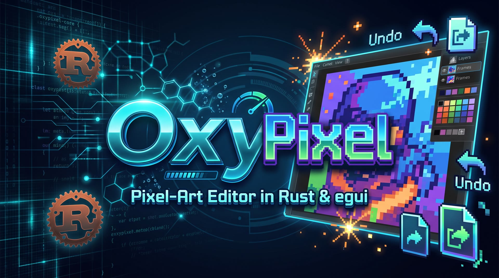

# OxyPixel



OxyPixel is a pixel-art editor for Windows and Linux. Draw on a pixel canvas, stack layers, animate frames, and import or export PNG, BMP, and GIF.

It is an original program written in Rust. The editing rules live in `oxypixel-core`. The window is an [egui](https://github.com/emilk/egui) app. OxyPixel is not affiliated with Pixelorama, Orama Interactive, Godot, or Aseprite.

**[Releases](https://github.com/crisprintsstuff/oxypixel/releases)** · **[Changelog](CHANGELOG.md)** · **[v0.2.0](https://github.com/crisprintsstuff/oxypixel/releases/tag/v0.2.0)**

## Contents

- [Download](#download)
- [Windows installer](#windows-installer)
- [Portable Windows build](#portable-windows-build)
- [Linux](#linux)
- [Features](#features)
- [Keyboard shortcuts](#keyboard-shortcuts)
- [Build from source](#build-from-source)
- [File formats](#file-formats)
- [Documentation](#documentation)
- [Contributing](#contributing)
- [Security](#security)
- [License](#license)

## Download

Current release: [v0.2.0](https://github.com/crisprintsstuff/oxypixel/releases/tag/v0.2.0). Older builds are on the [releases page](https://github.com/crisprintsstuff/oxypixel/releases). What changed is in the [changelog](CHANGELOG.md).

| File | Use |
| --- | --- |
| [OxyPixel-0.2.0-Setup.exe](https://github.com/crisprintsstuff/oxypixel/releases/download/v0.2.0/OxyPixel-0.2.0-Setup.exe) | Windows installer |
| [oxypixel-0.2.0-windows-x86_64.exe](https://github.com/crisprintsstuff/oxypixel/releases/download/v0.2.0/oxypixel-0.2.0-windows-x86_64.exe) | Portable Windows executable |
| [oxypixel-0.2.0-linux-x86_64.tar.gz](https://github.com/crisprintsstuff/oxypixel/releases/download/v0.2.0/oxypixel-0.2.0-linux-x86_64.tar.gz) | Linux x86_64 archive |
| [SHA256SUMS.txt](https://github.com/crisprintsstuff/oxypixel/releases/download/v0.2.0/SHA256SUMS.txt) | Checksums |

The Windows files are unsigned. SmartScreen can warn that the publisher is unknown. Check `SHA256SUMS.txt` before you install. Signing steps are in [docs/BUILD-WINDOWS.md](docs/BUILD-WINDOWS.md).

## Windows installer

`OxyPixel-0.2.0-Setup.exe` is a per-user NSIS setup.

1. Run the installer. It does not need administrator rights.
2. OxyPixel is installed under `%LOCALAPPDATA%\OxyPixel`.
3. The Start menu gets a shortcut, and `.oxypix` files open in OxyPixel. A desktop shortcut is optional.
4. Launch OxyPixel from the Start menu, or from the last page of setup.

The program needs OpenGL (`opengl32.dll`, which ships with Windows). The release executable links the C runtime statically, so the Visual C++ redistributable is not required.

## Portable Windows build

`oxypixel-0.2.0-windows-x86_64.exe` is the same 64-bit program without an installer. Put it in any folder and run it. This copy has no embedded icon or version resource. The installer shortcut uses `oxypixel.ico`.

## Linux

`oxypixel-0.2.0-linux-x86_64.tar.gz` contains the x86_64 executable, `LICENSE`, and `README.txt`. It was built on Ubuntu 24.04. It is not a `.deb`, RPM, AppImage, or Flatpak. Packaging ideas are in [docs/LINUX-PACKAGING.md](docs/LINUX-PACKAGING.md).

```bash
tar -xzf oxypixel-0.2.0-linux-x86_64.tar.gz
cd oxypixel-0.2.0-linux-x86_64
./oxypixel
```

The window needs an X11 display and these libraries: `libGL.so.1`, `libX11.so.6`, and `libxkbcommon.so.0`. Export commands do not need a display:

```bash
./oxypixel export-png drawing.oxypix frame.png
```

## Features

- Pixel canvas with nearest-neighbor zoom, pan, and an optional grid
- Pencil, eraser, fill, eyedropper, line, rectangle, ellipse, and rectangular selection
- Primary and secondary colors, hex entry, and the Ink palette
- Layers with visibility, opacity, rename, reorder, duplicate, and merge down
- Undo and redo
- Animation frames, playback, onion skin, GIF export, and a horizontal spritesheet
- `.oxypix` documents, plus PNG, BMP, and GIF import and export
- Keyboard shortcuts

A canvas side is at most 1024 pixels. One cel holds at most 1,048,576 pixels. The whole document holds at most 16,777,216 pixels across frames and layers. Details are in [docs/FORMAT.md](docs/FORMAT.md).

## Keyboard shortcuts

| Keys | Action |
| --- | --- |
| B, E, G, I | Pencil, eraser, fill, eyedropper |
| L, R, O, M | Line, rectangle, ellipse, select |
| Ctrl+Z / Ctrl+Y | Undo / redo |
| Ctrl+N / Ctrl+O / Ctrl+S | New, open, save |
| Enter | Play or pause |
| Space+drag | Pan |
| Ctrl+Plus / Ctrl+Minus / Ctrl+0 | Zoom in, zoom out, fit |

The full list is [docs/SHORTCUTS.md](docs/SHORTCUTS.md).

## Build from source

Rust 1.99.0 is pinned in `rust-toolchain.toml`.

```bash
cargo test --workspace
cargo run -p oxypixel
```

Headless export:

```bash
oxypixel export-png sprite.oxypix frame.png
oxypixel export-bmp sprite.oxypix frame.bmp
oxypixel export-gif sprite.oxypix animation.gif
oxypixel export-sheet sprite.oxypix sheet.png
```

| Script | Result |
| --- | --- |
| [scripts/build-windows.sh](scripts/build-windows.sh) | Portable `oxypixel-<version>-windows-x86_64.exe` |
| [scripts/build-installer.sh](scripts/build-installer.sh) | `OxyPixel-<version>-Setup.exe` |
| [scripts/package-linux.sh](scripts/package-linux.sh) | `oxypixel-<version>-linux-x86_64.tar.gz` |

`make test` runs the test suite. `make check` runs rustfmt, clippy, and the tests.

## File formats

`.oxypix` is the editor's own little-endian document. Version 1 stores the canvas, shared layer stack, frame durations, pixels, and palette. The byte layout is [docs/FORMAT.md](docs/FORMAT.md).

PNG, BMP, and GIF can be imported as a new document or as a layer. Export writes the composited frame, a GIF animation, a BMP, or a horizontal PNG spritesheet.

## Documentation

| Guide | What it covers |
| --- | --- |
| [CHANGELOG.md](CHANGELOG.md) | Release history |
| [docs/ARCHITECTURE.md](docs/ARCHITECTURE.md) | Core library and the egui window |
| [docs/SHORTCUTS.md](docs/SHORTCUTS.md) | Keyboard and mouse shortcuts |
| [docs/FORMAT.md](docs/FORMAT.md) | `.oxypix` layout and size limits |
| [docs/BUILD-WINDOWS.md](docs/BUILD-WINDOWS.md) | Windows build, installer, and code signing |
| [docs/LINUX-PACKAGING.md](docs/LINUX-PACKAGING.md) | Linux archive and future packages |
| [docs/THIRD-PARTY.md](docs/THIRD-PARTY.md) | Direct dependency licenses |
| [CONTRIBUTING.md](CONTRIBUTING.md) | Tests, pull requests, and version bumps |
| [SECURITY.md](SECURITY.md) | File parsing limits and how to report a problem |

## Contributing

Use a focused branch. Run `make check` before asking for review. Do not copy code or artwork from other pixel editors. The full notes are in [CONTRIBUTING.md](CONTRIBUTING.md).

## Security

OxyPixel stays on the local machine. It does not open a network connection. Document parsing rejects oversized files before it allocates the pixel buffers. Report a problem the way [SECURITY.md](SECURITY.md) describes.

## License

MIT. See [LICENSE](LICENSE).
