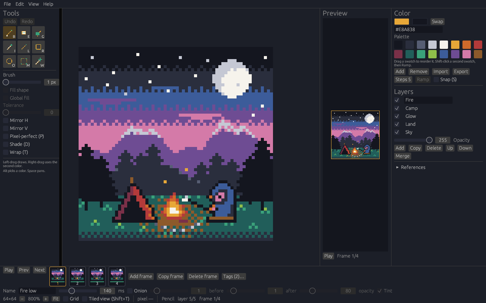
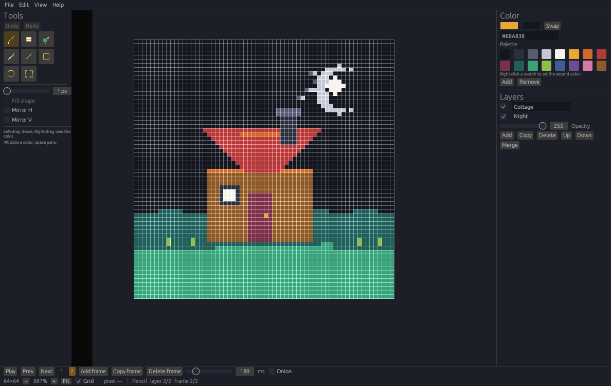

# OxyPixel

OxyPixel is a pixel-art editor for making sprites and short animations on Windows and Linux. You draw on a pixel canvas, stack layers, and step through frames, then save an `.oxypix` document or export PNG, BMP, or GIF. The editing rules live in the `oxypixel-core` library, and the window is an [egui](https://github.com/emilk/egui) app. OxyPixel is an original program. It is not affiliated with Pixelorama, Orama Interactive, Godot, or Aseprite.

**[Releases](https://github.com/crisprintsstuff/oxypixel/releases)** · **[Changelog](CHANGELOG.md)** · **[Latest](https://github.com/crisprintsstuff/oxypixel/releases/latest)** · **[Roadmap](docs/ROADMAP.md)**





The pictures above are screenshots of the running editor. The drawing is a sample file opened for the capture. The images are in [docs/images/](docs/images/) and are covered by the repository MIT license.

## Contents

- [Status](#status)
- [Download](#download)
- [Windows installer](#windows-installer)
- [Portable Windows build](#portable-windows-build)
- [Linux](#linux)
- [Features](#features)
- [How it's built](#how-its-built)
- [Keyboard shortcuts](#keyboard-shortcuts)
- [Build from source](#build-from-source)
- [File formats](#file-formats)
- [Documentation](#documentation)
- [Contributing](#contributing)
- [Security](#security)
- [License](#license)

## Status

OxyPixel is an early release. The Windows downloads are unsigned. Linux publishes a tar.gz and a `.deb`. A canvas side is at most 1024 pixels. What works today, and the open task list, is in [docs/ROADMAP.md](docs/ROADMAP.md).

## Download

The files for the current release are on the [latest release](https://github.com/crisprintsstuff/oxypixel/releases/latest). Older builds are on the [releases page](https://github.com/crisprintsstuff/oxypixel/releases). What changed is in the [changelog](CHANGELOG.md).

| File | Use |
| --- | --- |
| `OxyPixel-<version>-Setup.exe` | Windows installer |
| `oxypixel-<version>-windows-x86_64.exe` | Portable Windows executable |
| `oxypixel-<version>-linux-x86_64.tar.gz` | Linux x86_64 archive |
| `oxypixel-<version>-linux-x86_64.deb` | Linux Debian package |
| [`SHA256SUMS.txt`](https://github.com/crisprintsstuff/oxypixel/releases/latest/download/SHA256SUMS.txt) | Checksums |

The Windows files are unsigned. SmartScreen can warn that the publisher is unknown. Check `SHA256SUMS.txt` before you install. Signing steps are in [docs/BUILD-WINDOWS.md](docs/BUILD-WINDOWS.md).

## Windows installer

`OxyPixel-<version>-Setup.exe` is a per-user NSIS setup.

1. Run the installer. It does not need administrator rights.
2. If SmartScreen says the publisher is unknown, use "More info" and then "Run anyway" after the checksum matches.
3. OxyPixel is installed under `%LOCALAPPDATA%\OxyPixel`.
4. The Start menu gets a shortcut, and `.oxypix` files open in OxyPixel. A desktop shortcut is optional.
5. Launch OxyPixel from the Start menu, or from the last page of setup.

The program needs OpenGL (`opengl32.dll`, which ships with Windows). The release executable links the C runtime statically, so the Visual C++ redistributable is not required.

## Portable Windows build

`oxypixel-<version>-windows-x86_64.exe` is the same 64-bit program without an installer. Put it in any folder and run it. SmartScreen can show the same unknown-publisher warning as the installer.

The tagged Windows build embeds the application icon and a version resource when `rc.exe` is on `PATH`. The release workflow adds that compiler from the Windows SDK. A cross-build made without `rc.exe`, `llvm-rc`, or `windres` on `PATH` does not embed those resources, and File Explorer then shows a generic icon for the exe. The installer shortcut and the `.oxypix` association use `oxypixel.ico` either way. See [docs/BUILD-WINDOWS.md](docs/BUILD-WINDOWS.md).

Help, then Check for updates, can download a newer release and restart into it after the checksum matches.

## Linux

Each release publishes two Linux files.

`oxypixel-<version>-linux-x86_64.tar.gz` is the x86_64 executable, `LICENSE`, and `README.txt`. Unpack it and run the program from that directory. For 0.5.0:

```bash
tar -xzf oxypixel-0.5.0-linux-x86_64.tar.gz
cd oxypixel-0.5.0-linux-x86_64
./oxypixel
```

`oxypixel-<version>-linux-x86_64.deb` installs `/usr/bin/oxypixel`, a desktop entry, a 32×32 icon, and the `.oxypix` mime type. For 0.5.0 the Debian package version is `0.5.0-1`:

```bash
sudo apt install ./oxypixel-0.5.0-linux-x86_64.deb
sudo apt remove oxypixel
```

On Ubuntu 24.04, `apt install` and `apt remove` were checked for a package built from this tree. Releases before the `.deb` was added published the tar.gz only.

The window needs an X11 display and these libraries: `libGL.so.1`, `libX11.so.6`, `libxkbcommon.so.0`, and `libxkbcommon-x11.so.0`. Wayland copy and paste also loads `libwayland-client.so.0` when the compositor offers the data-control clipboard. The `.deb` depends on the packages that provide them (`libgl1`, `libx11-6`, `libxkbcommon0`, `libxkbcommon-x11-0`, `libxcb1`). Export commands do not need a display:

```bash
oxypixel export-png drawing.oxypix frame.png
```

RPM, AppImage, and Flatpak are not built. Notes are in [docs/LINUX-PACKAGING.md](docs/LINUX-PACKAGING.md).

Help, then Check for updates, downloads the tar.gz for an unpacked copy and the `.deb` when the running program is `/usr/bin/oxypixel`. A packaged copy stays in place. Install the downloaded `.deb` with the package manager.

## Features

These match the current editor. Planned work is listed in [docs/ROADMAP.md](docs/ROADMAP.md) and is not included here.

- Pixel canvas with nearest-neighbor zoom on whole-pixel steps, pan, and an optional grid
- Pencil, eraser, fill, eyedropper, line, rectangle, ellipse, and rectangular selection
- Move, nudge, flip, and rotate a selection (or the active cel when nothing is selected). A 90° turn swaps the sides and stays centered; pixels that do not fit are dropped. Copy publishes a straight-alpha image to the system clipboard and keeps an in-memory patch. Paste uses the system image, or that patch when the clipboard has no image
- Canvas resize and crop
- Horizontal and vertical mirror while drawing
- Pixel-perfect pencil (P), off until you turn it on, drops the extra corner of a one-pixel diagonal step. The line tool is unchanged
- Wrap (T) continues a stroke or fill that leaves an edge on the opposite edge. Tiled view (Shift+T) shows the canvas 3 by 3. Export still writes one copy
- Primary and secondary colors, hex entry, and the Ink palette
- Import and export the palette as GIMP `.gpl`, hex `.hex` (one `RRGGBB` per line), or JASC `.pal`. Import replaces the palette and can be undone. Drag swatches to reorder them, and fill a ramp of N steps between two swatches. Snap (S) makes pencil, fill, and shapes use the nearest palette color
- Layers with visibility, opacity, rename, reorder, duplicate, and merge down
- Undo and redo, including the selection rectangle
- Animation frames with thumbnails, playback, onion skin for earlier and later frames, a duration up to 10 seconds, GIF export, and a horizontal spritesheet
- A preview panel of the whole image, with its own playback, that pans the canvas when you click it
- PNG and spritesheet export at 1×, 2×, or 4× nearest-neighbor
- `.oxypix` documents, plus PNG, BMP, and GIF import and export
- Reference images (PNG or JPEG) on the canvas or in a floating panel. They are left out of export unless you copy one onto a layer. Dropping a JPEG loads a reference; a dropped PNG still imports. Save writes the paths and placement beside the document, not inside the `.oxypix` file. An image in the document's folder is stored by a relative path, so the folder can move
- Recent files (a folder hint when names match, a missing-file mark, and Clear recent), drag-and-drop, a Windows file dialog, and a Linux portal dialog with a path field if the portal is unavailable
- Autosave writes a recovery copy about once a minute, and after a run of edits, into the app data folder. It does not overwrite the open file. The next launch can restore or discard that copy, including a drawing that was never saved. Turn it off from the File menu
- Headless `export-png`, `export-bmp`, `export-gif`, `export-sheet`, `export-palette`, and `import-palette` commands
- Keyboard shortcuts

A canvas side is at most 1024 pixels. One cel holds at most 1,048,576 pixels. The whole document holds at most 16,777,216 pixels across frames and layers. Details are in [docs/FORMAT.md](docs/FORMAT.md).

## How it's built

The maintainer develops OxyPixel with AI coding agents. The written rules for that work are in [AGENTS.md](AGENTS.md): which crate owns which behavior, errors instead of panics on bad input, and no modal dialogs on headless, CLI, or test paths. Changes are expected to include tests. GitHub Actions runs rustfmt, clippy with warnings denied, and the test suite on Linux and Windows. The maintainer reviews and merges pull requests.

## Keyboard shortcuts

| Keys | Action |
| --- | --- |
| B, E, G, I | Pencil, eraser, fill, eyedropper |
| L, R, O, M | Line, rectangle, ellipse, select |
| Ctrl+Z / Ctrl+Y | Undo / redo |
| Ctrl+C / Ctrl+V | Copy / paste the selection image |
| Arrow keys | Nudge the selection |
| P | Pixel-perfect pencil |
| T / Shift+T | Wrap drawing / tiled view |
| S | Snap pencil, fill, and shapes to the nearest palette color |
| Shift+H / Shift+V | Flip horizontal / vertical |
| Shift+. / Shift+, / Ctrl+Shift+. | Rotate 90° clockwise, counter-clockwise, or 180° |
| Comma / Period | Previous / next frame |
| Ctrl+N / Ctrl+O / Ctrl+S | New, open, save |
| Enter | Play or pause |
| Space+drag | Pan |
| Ctrl+Plus / Ctrl+Minus / Ctrl+0 | Zoom in, zoom out (whole-pixel steps), fit |

The full list is [docs/SHORTCUTS.md](docs/SHORTCUTS.md).

## Build from source

Rust 1.99.0 is pinned in `rust-toolchain.toml`.

```bash
cargo test --workspace
cargo run -p oxypixel
```

Headless export:

```bash
oxypixel export-png sprite.oxypix frame.png
oxypixel export-bmp sprite.oxypix frame.bmp
oxypixel export-gif sprite.oxypix animation.gif
oxypixel export-sheet sprite.oxypix sheet.png
oxypixel export-palette sprite.oxypix palette.gpl
oxypixel import-palette sprite.oxypix palette.gpl recolored.oxypix
```

| Script | Result |
| --- | --- |
| [scripts/build-windows.sh](scripts/build-windows.sh) | Portable `oxypixel-<version>-windows-x86_64.exe` |
| [scripts/build-installer.sh](scripts/build-installer.sh) | `OxyPixel-<version>-Setup.exe` |
| [scripts/package-linux.sh](scripts/package-linux.sh) | `oxypixel-<version>-linux-x86_64.tar.gz` |
| [scripts/package-deb.sh](scripts/package-deb.sh) | `oxypixel-<version>-linux-x86_64.deb` |

`make test` runs the test suite. `make check` runs rustfmt, clippy, and the tests.

## File formats

`.oxypix` is the editor's own little-endian document. Version 1 stores the canvas, shared layer stack, frame durations, pixels, and palette. The byte layout is [docs/FORMAT.md](docs/FORMAT.md).

PNG, BMP, and GIF can be imported as a new document or as a layer. A GIF import becomes one composited layer named Imported. Export writes the composited frame, a GIF animation, a BMP, or a horizontal PNG spritesheet.

Palette import and export use GIMP `.gpl`, a hex list (`.hex`, one `RRGGBB` per line, or `RRGGBBAA` when the color has alpha), and JASC `.pal`. A `.txt` file is read as that hex list. Import replaces the document palette. JASC files store opaque colors, so alpha becomes 255.

## Documentation

| Guide | What it covers |
| --- | --- |
| [CHANGELOG.md](CHANGELOG.md) | Release history |
| [AGENTS.md](AGENTS.md) | Rules for contributors and coding agents |
| [docs/ROADMAP.md](docs/ROADMAP.md) | Scorecard and the open task ids |
| [docs/ARCHITECTURE.md](docs/ARCHITECTURE.md) | Core library and the egui window |
| [docs/SHORTCUTS.md](docs/SHORTCUTS.md) | Keyboard and mouse shortcuts |
| [docs/FORMAT.md](docs/FORMAT.md) | `.oxypix` layout and size limits |
| [docs/BUILD-WINDOWS.md](docs/BUILD-WINDOWS.md) | Windows build, installer, and code signing |
| [docs/LINUX-PACKAGING.md](docs/LINUX-PACKAGING.md) | Linux tar.gz, `.deb`, and packages that are still only a plan |
| [docs/THIRD-PARTY.md](docs/THIRD-PARTY.md) | Direct dependency licenses |
| [CONTRIBUTING.md](CONTRIBUTING.md) | Tests, pull requests, and version bumps |
| [SECURITY.md](SECURITY.md) | File parsing limits and how to report a problem |

## Contributing

Bug reports and small pull requests are welcome. Open a [GitHub issue](https://github.com/crisprintsstuff/oxypixel/issues) for a defect, and use the path in [SECURITY.md](SECURITY.md) for a security problem. Use a focused branch. Run `make check` before asking for review. Do not copy code or artwork from other pixel editors.

People and coding agents working in the tree should read [AGENTS.md](AGENTS.md) and take the next open id from [docs/ROADMAP.md](docs/ROADMAP.md). The full notes are in [CONTRIBUTING.md](CONTRIBUTING.md).

## Security

OxyPixel does not open a network connection on its own. Help, then Check for updates, is the one request to GitHub, and it downloads a file only after `SHA256SUMS.txt` matches. Document parsing rejects oversized files before it allocates the pixel buffers. Report a problem the way [SECURITY.md](SECURITY.md) describes.

## License

MIT. See [LICENSE](LICENSE).
