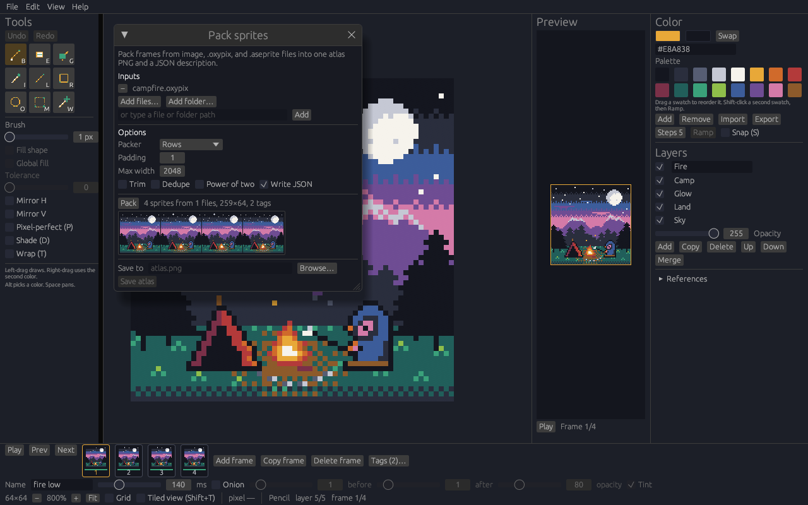

# OxyPixel

OxyPixel is a pixel-art editor for making sprites and short animations on Windows and Linux. Draw on a pixel canvas, stack layers, step through named frames and animation tags, then save an `.oxypix` document or export PNG, BMP, GIF, or a spritesheet with JSON for game engines. It comes with [OxyPack](#oxypack), a sprite atlas packer that also reads Aseprite files, as a command and as a window inside the editor.

The editing rules live in the `oxypixel-core` library, and the window is an [egui](https://github.com/emilk/egui) app. OxyPixel is an original program. It is not affiliated with Pixelorama, Orama Interactive, Godot, or Aseprite.

**[Releases](https://github.com/crisprintsstuff/oxypixel/releases)** · **[Changelog](CHANGELOG.md)** · **[Latest](https://github.com/crisprintsstuff/oxypixel/releases/latest)** · **[Roadmap](docs/ROADMAP.md)**


The pictures above are screenshots of OxyPixel 0.9.0. The drawing is a sample file opened for the capture. The images are in [docs/images/](docs/images/) and are covered by the repository MIT license.

## Contents

- [Status](#status)
- [Download](#download)
- [Windows installer](#windows-installer)
- [Portable Windows build](#portable-windows-build)
- [Linux](#linux)
- [Features](#features)
- [Updates](#updates)
- [How it's built](#how-its-built)
- [Keyboard shortcuts](#keyboard-shortcuts)
- [OxyPack](#oxypack)
- [MCP server for AI assistants](#mcp-server-for-ai-assistants)
- [Build from source](#build-from-source)
- [File formats](#file-formats)
- [Documentation](#documentation)
- [Contributing](#contributing)
- [Security](#security)
- [License](#license)

## Status

OxyPixel 0.9.2 is an early release. The Windows downloads are unsigned. Linux publishes a tar.gz and a `.deb`. A canvas side is at most 1024 pixels. What works today, and the open task list, is in [docs/ROADMAP.md](docs/ROADMAP.md).

## Download

The files for the current release are on the [latest release](https://github.com/crisprintsstuff/oxypixel/releases/latest). Older builds are on the [releases page](https://github.com/crisprintsstuff/oxypixel/releases). What changed is in the [changelog](CHANGELOG.md).

| File | Use |
| --- | --- |
| `OxyPixel-<version>-Setup.exe` | Windows installer |
| `oxypixel-<version>-windows-x86_64.exe` | Portable Windows executable |
| `oxypixel-<version>-linux-x86_64.tar.gz` | Linux x86_64 archive |
| `oxypixel-<version>-linux-x86_64.deb` | Linux Debian package |
| `oxypack-<version>-windows-x86_64.exe` | [OxyPack](#oxypack) sprite packer for Windows. The Linux archive and `.deb` include `oxypack` |
| [`SHA256SUMS.txt`](https://github.com/crisprintsstuff/oxypixel/releases/latest/download/SHA256SUMS.txt) | Checksums for the editor downloads, used by Check for updates |
| `SHA256SUMS-windows.txt`, `SHA256SUMS-linux.txt` | Checksums for each platform's files, including `oxypack-<version>-windows-x86_64.exe` |

The Windows files are unsigned. SmartScreen can warn that the publisher is unknown. Check `SHA256SUMS.txt` before you install. Signing steps are in [docs/BUILD-WINDOWS.md](docs/BUILD-WINDOWS.md).

## Windows installer

`OxyPixel-<version>-Setup.exe` is a per-user NSIS setup.

1. Run the installer. It does not need administrator rights.
2. If SmartScreen says the publisher is unknown, use "More info" and then "Run anyway" after the checksum matches.
3. OxyPixel is installed under `%LOCALAPPDATA%\OxyPixel`, with the `oxypack.exe` sprite packer beside `oxypixel.exe`. Setup does not change `PATH`, so call it by its full path, for example `"%LOCALAPPDATA%\OxyPixel\oxypack.exe" sprites -o atlas.png`.
4. The Start menu gets a shortcut, and `.oxypix` files open in OxyPixel. A desktop shortcut is optional.
5. Launch OxyPixel from the Start menu, or from the last page of setup.

The window draws with Direct3D 12 through wgpu, which every supported Windows has; without a GPU it uses Windows' software renderer (WARP). If that fails, it falls back to OpenGL 2.0 or newer. The release executable links the C runtime statically, so the Visual C++ redistributable is not required.

## Portable Windows build

`oxypixel-<version>-windows-x86_64.exe` is the same 64-bit program without an installer. Put it in any folder and run it. SmartScreen can show the same unknown-publisher warning as the installer.

The tagged Windows build embeds the application icon and a version resource when `rc.exe` is on `PATH`. The release workflow adds that compiler from the Windows SDK. A cross-build made without `rc.exe`, `llvm-rc`, or `windres` on `PATH` does not embed those resources, and File Explorer then shows a generic icon for the exe. The installer shortcut and the `.oxypix` association use `oxypixel.ico` either way. See [docs/BUILD-WINDOWS.md](docs/BUILD-WINDOWS.md).

## Linux

Each release publishes two Linux files.

`oxypixel-<version>-linux-x86_64.tar.gz` holds the x86_64 `oxypixel` and `oxypack` executables, `LICENSE`, and `README.txt`. Unpack it and run the program from that directory. For 0.9.2:

```bash
tar -xzf oxypixel-0.9.2-linux-x86_64.tar.gz
cd oxypixel-0.9.2-linux-x86_64
./oxypixel
```

`oxypixel-<version>-linux-x86_64.deb` installs `/usr/bin/oxypixel`, `/usr/bin/oxypack`, a desktop entry, a 32×32 icon, and the `.oxypix` mime type. For 0.9.2 the Debian package version is `0.9.2-1`:

```bash
sudo apt install ./oxypixel-0.9.2-linux-x86_64.deb
sudo apt remove oxypixel
```

On Ubuntu 24.04, `apt install` and `apt remove` were checked for a package built from this tree. Releases before the `.deb` was added published the tar.gz only.

The window needs an X11 display. It draws with Vulkan through wgpu when a Vulkan driver is installed (`libvulkan1` and, for example, `mesa-vulkan-drivers`), and otherwise falls back to OpenGL. It needs these libraries: `libGL.so.1`, `libX11.so.6`, `libxkbcommon.so.0`, and `libxkbcommon-x11.so.0`. Wayland copy and paste also loads `libwayland-client.so.0` when the compositor offers the data-control clipboard. The `.deb` depends on the packages that provide them (`libgl1`, `libx11-6`, `libxkbcommon0`, `libxkbcommon-x11-0`, `libxcb1`). Export commands do not need a display:

```bash
oxypixel export-png drawing.oxypix frame.png
```

RPM, AppImage, and Flatpak are not built. Notes are in [docs/LINUX-PACKAGING.md](docs/LINUX-PACKAGING.md).

## Features

These match the current editor. Planned work is listed in [docs/ROADMAP.md](docs/ROADMAP.md) and is not included here.

### Drawing

- Pencil, eraser, fill, eyedropper, line, rectangle, ellipse, rectangular selection, and a magic wand
- Fill and the wand have a tolerance for near colors and a global mode that takes every match on the layer
- Pixel-perfect pencil (P), off until you turn it on, drops the extra corner of a one-pixel diagonal step
- Shade (D) turns the pencil into a shading brush: left steps each pixel to the next palette swatch, right to the one before
- Horizontal and vertical mirror while drawing
- Wrap (T) continues a stroke or fill that leaves one edge on the opposite edge. Tiled view (Shift+T) shows the canvas 3 by 3 for checking a repeating tile
- Nearest-neighbor zoom in whole-pixel steps, pan, and an optional grid
- Undo and redo, including the selection

### Selections

- Shift adds a marquee or wand area to the selection and Alt cuts it out, so a selection can be any shape
- Move, nudge, flip, and rotate a selection, or the active cel when nothing is selected. A 90° turn swaps the sides and stays centered
- Copy puts a straight-alpha image on the system clipboard. Paste uses the system image, or the last copy when the clipboard has no image
- Canvas resize and crop

### Color and palette

- Primary and secondary colors, hex entry, and the 16-color Ink palette
- Drag swatches to reorder them, and fill a ramp of N steps between two swatches
- Snap (S) makes pencil, fill, and shapes use the nearest palette color
- Import and export the palette as GIMP `.gpl`, hex `.hex`, or JASC `.pal`. Import replaces the palette and can be undone

### Layers

- Visibility, opacity, rename, reorder, duplicate, and merge down
- Layer groups: Group puts the selected layer in a new group, In and Out move layers into and out of the group below or around them, and Up, Down, Copy, and Delete move or copy a whole group. A group is drawn as one picture with its own visibility, opacity, and blend mode
- Blend modes on each layer: Multiply, Screen, Overlay, Darken, Lighten, Color dodge and burn, Hard and Soft light, Difference, Exclusion, Hue, Saturation, Color, Luminosity, Addition, Subtract, and Divide. Exports, OxyPack, and the MCP server draw them too
- Reference images (PNG or JPEG) on the canvas or in a floating panel, behind the art by default. Ctrl+drag moves one, and Fit to canvas scales it to the document. They are left out of export and saved beside the document, not inside it

### Animation

- Frames with thumbnails, playback, and a duration up to 10 seconds each
- Frame names, typed in the Name field beside the duration. The spritesheet JSON and OxyPack use them
- Animation tags: name a range of frames, choose forward, reverse, or ping-pong and a repeat count, and see each tag marked on the frame strip. Tags are saved in the document and exported in the spritesheet JSON
- Onion skin for earlier and later frames, with a tint
- A preview panel of the whole image, with its own playback, that pans the canvas when you click it

### Import and export

- `.oxypix` documents, plus PNG, BMP, and GIF import and export
- PNG and spritesheet export at 1×, 2×, or 4× nearest-neighbor. A spritesheet can be a row or a grid, with padding and a JSON description for game engines
- GIF animation export
- Pack sprites (File menu): pack frames from image, `.oxypix`, and `.aseprite` files into an atlas PNG and JSON. See [OxyPack](#oxypack)
- Headless `export-png`, `export-bmp`, `export-gif`, `export-sheet`, `export-palette`, and `import-palette` commands that never open a window

### Settings

- Edit, then Settings… (Ctrl+,) holds the app settings in one window, grouped as General, Canvas, Onion skin, Export, and Updates. Changes apply right away and are kept for the next launch, and Reset to defaults puts them all back
- Interface scale (75% to 200%), the size File, then New starts with, grid on or off, a dark or light checkerboard behind clear pixels, onion skin frame counts, opacity, and tint, the export scale, autosave recovery, automatic updates, and Clear recent files

### Files and recovery

- Recent files, with a folder hint when names match, a missing-file mark, and Clear recent
- Drag-and-drop, a Windows file dialog, and a Linux portal dialog with a path field if the portal is unavailable
- Autosave writes a recovery copy about once a minute into the app data folder, without touching the open file. The next launch can restore or discard it, including a drawing that was never saved. Turn it off from the File menu

A canvas side is at most 1024 pixels. One cel holds at most 1,048,576 pixels. The whole document holds at most 16,777,216 pixels across frames and layers. Details are in [docs/FORMAT.md](docs/FORMAT.md).

## Updates

Help, then Check for updates, looks at the public releases on GitHub. If a newer one has a file for your system, OxyPixel downloads it and checks it against `SHA256SUMS.txt` before it is used:

- **Windows installer copy:** opens the new installer.
- **Portable Windows copy:** replaces itself and restarts.
- **Unpacked Linux copy:** replaces `oxypixel` from the new tar.gz and restarts.
- **`.deb` copy** (`/usr/bin/oxypixel`): downloads the new `.deb` and leaves it for you to install with your package manager.

You have to save or discard the open drawing first.

**Automatic updates** is off by default. Turn it on in the Help menu or in the Check for updates window. OxyPixel then checks once a day at launch without opening a window, downloads and verifies a newer release in the background, and shows an "Update … ready" button in the menu bar. Nothing is installed until you click it.

## How it's built

The maintainer develops OxyPixel with AI coding agents. The written rules for that work are in [AGENTS.md](AGENTS.md): which crate owns which behavior, errors instead of panics on bad input, and no modal dialogs on headless, CLI, or test paths. Changes are expected to include tests. GitHub Actions runs rustfmt, clippy with warnings denied, and the test suite on Linux and Windows. The maintainer reviews and merges pull requests.

## Keyboard shortcuts

| Keys | Action |
| --- | --- |
| B, E, G, I | Pencil, eraser, fill, eyedropper |
| L, R, O, M, W | Line, rectangle, ellipse, select, magic wand |
| Shift / Alt with M or W | Add to / cut from the selection |
| Ctrl+Z / Ctrl+Y | Undo / redo |
| Ctrl+C / Ctrl+V | Copy / paste the selection image |
| Arrow keys | Nudge the selection |
| P | Pixel-perfect pencil |
| T / Shift+T | Wrap drawing / tiled view |
| S | Snap pencil, fill, and shapes to the nearest palette color |
| Shift+H / Shift+V | Flip horizontal / vertical |
| Shift+. / Shift+, / Ctrl+Shift+. | Rotate 90° clockwise, counter-clockwise, or 180° |
| Comma / Period | Previous / next frame |
| Ctrl+N / Ctrl+O / Ctrl+S | New, open, save |
| Ctrl+, | Settings |
| Enter | Play or pause |
| Space+drag | Pan |
| Ctrl+drag | Move a reference image |
| Ctrl+Plus / Ctrl+Minus / Ctrl+0 | Zoom in, zoom out (whole-pixel steps), fit |

The full list is [docs/SHORTCUTS.md](docs/SHORTCUTS.md).

## OxyPack

OxyPack packs sprites from many files into one atlas PNG and writes a JSON hash beside it, the layout Phaser, PixiJS, Godot importers, and Aseprite's own exporter read. It is a command-line tool, `oxypack`, and the same packer is in the editor under File, then Pack sprites….

```bash
oxypack sprites/ hero.oxypix --trim --dedupe -o atlas.png
```



### What it reads

- `.png`, `.bmp`, `.gif`, `.oxypix`, and Aseprite `.aseprite` / `.ase` files, or folders of them (not searched recursively)
- Every frame of an animation becomes a sprite with its duration. It is named `<file> <frame name>` when the frame has a name, and `<file> 0`, `<file> 1`, and so on otherwise. A one-frame file is named after the file
- Aseprite files are drawn the way Aseprite flattens them for export:
  - visible layers with their opacity; hidden and reference layers are left out
  - layer blend modes (Multiply, Screen, Overlay, and the rest of Aseprite's list), and group opacity and blending
  - tilemap layers drawn from their tilesets, flipped tiles included. A tileset kept in another file is skipped, with a note on stderr
- Tags from Aseprite files and from tagged `.oxypix` documents are written to `meta.frameTags` with their direction and repeat count. They are numbered by the sprites' order in the JSON, so a tag still points at the right frames when several files share one atlas

### Options

| Option | Effect |
| --- | --- |
| `-o`, `--output <path>` | Atlas PNG to write (required). The JSON goes beside it |
| `--padding N` | Clear pixels between sprites (default 1) |
| `--max-width N` | Widest the atlas may be (default 2048) |
| `--trim` | Crop each sprite to its ink and record the offset |
| `--dedupe` | Store repeated frames once |
| `--pot` | Round the atlas size up to powers of two |
| `--packer maxrects` | Fill the gaps rows leave, for a shorter atlas (default `shelf`) |
| `--no-json` | Write only the PNG |

The command never opens a window, so it fits build scripts and CI. The Pack sprites window takes files and folders (from the system dialog or a typed path), shows the packed atlas, and saves the same PNG and JSON the command would.

### Where to find it

- **Windows:** the installer puts `oxypack.exe` in `%LOCALAPPDATA%\OxyPixel`, and there is also a standalone `oxypack-<version>-windows-x86_64.exe` download.
- **Linux:** the archive has `./oxypack` beside `./oxypixel`, and the `.deb` installs `/usr/bin/oxypack`.
- **From source:** `cargo build --release -p oxypack`.

Outside tests: a tester ran the `oxypack` command from the 0.7.5 Linux build. With 0.8.0, `.aseprite` files saved by Aseprite 1.13.18.6 packed to the same frames as Aseprite's own export. Reports on other files and versions are welcome in an issue.

## MCP server for AI assistants

`oxypixel mcp` is a [Model Context Protocol](https://modelcontextprotocol.io) server, so an AI assistant such as Claude Desktop or Claude Code can make and edit pixel art with OxyPixel. The assistant starts the command and talks to it over stdin and stdout. It opens no window and makes no network connection.

| Tool | What it does |
| --- | --- |
| `document_info` | Size, layers, frames with durations and names, tags, and palette of a `.oxypix` |
| `render` | One frame as a PNG image, scaled up, so the assistant can see its work |
| `create_document` | A new document, clear or filled with a color |
| `draw` | Pixels, erasing, lines, rectangles, ellipses, and fills, with the editor's own tools |
| `add_layer`, `set_layer` | Add, rename, hide, fade, or delete layers |
| `add_frame`, `set_frame` | Add or copy frames, and rename, time, or delete them |
| `set_tags`, `set_palette` | Replace the animation tags or the palette |
| `export` | PNG, BMP, GIF, or a spritesheet with JSON |
| `pack_sprites` | The OxyPack atlas packer |

Editing tools save the document in place. `create_document`, `export`, and `pack_sprites` will not replace an existing file unless the call says `overwrite: true`. Add `--root DIR` to keep every path the tools read or write inside one folder.

Claude Code:

```bash
claude mcp add oxypixel -- oxypixel mcp --root ~/sprites
```

Claude Desktop, in `claude_desktop_config.json`. On Windows, set `command` to the full path of `oxypixel.exe` (the installer puts it in `%LOCALAPPDATA%\OxyPixel`), writing each `\` as `\\` in JSON. On Linux the `.deb` installs `/usr/bin/oxypixel`.

```json
{
  "mcpServers": {
    "oxypixel": {
      "command": "oxypixel",
      "args": ["mcp", "--root", "/home/you/sprites"]
    }
  }
}
```

Then ask, for example: "Make a 16×16 coin in coin.oxypix with a four-frame spin, tag it spin, and export a spritesheet with JSON."

## Build from source

Rust 1.99.0 is pinned in `rust-toolchain.toml`.

```bash
cargo test --workspace
cargo run -p oxypixel
```

Headless export:

```bash
oxypixel export-png sprite.oxypix frame.png
oxypixel export-bmp sprite.oxypix frame.bmp
oxypixel export-gif sprite.oxypix animation.gif
oxypixel export-sheet sprite.oxypix sheet.png
oxypixel export-sheet sprite.oxypix sheet.png --columns 4 --padding 1 --json
oxypixel export-palette sprite.oxypix palette.gpl
oxypixel import-palette sprite.oxypix palette.gpl recolored.oxypix
```

| Script | Result |
| --- | --- |
| [scripts/build-windows.sh](scripts/build-windows.sh) | Portable `oxypixel-<version>-windows-x86_64.exe` |
| [scripts/build-installer.sh](scripts/build-installer.sh) | `OxyPixel-<version>-Setup.exe` |
| [scripts/package-linux.sh](scripts/package-linux.sh) | `oxypixel-<version>-linux-x86_64.tar.gz` |
| [scripts/package-deb.sh](scripts/package-deb.sh) | `oxypixel-<version>-linux-x86_64.deb` |

`make test` runs the test suite. `make check` runs rustfmt, clippy, and the tests.

## File formats

`.oxypix` is the editor's own little-endian document. Version 1 stores the canvas, shared layer stack, frame durations, pixels, and palette. Version 2 adds animation tags, frame names, layer blend modes, and layer groups and is written only when a document has one of them; OxyPixel 0.8.5 and earlier open version 1 only, and a file with blend modes or groups needs OxyPixel newer than 0.9.2. The byte layout is [docs/FORMAT.md](docs/FORMAT.md).

PNG, BMP, and GIF can be imported as a new document or as a layer. A GIF import becomes one composited layer named Imported. Export writes the composited frame, a GIF animation, a BMP, or a PNG spritesheet in a row or a grid, optionally with a JSON description.

Palette import and export use GIMP `.gpl`, a hex list (`.hex`, one `RRGGBB` per line, or `RRGGBBAA` when the color has alpha), and JASC `.pal`. A `.txt` file is read as that hex list. Import replaces the document palette. JASC files store opaque colors, so alpha becomes 255.

## Documentation

| Guide | What it covers |
| --- | --- |
| [CHANGELOG.md](CHANGELOG.md) | Release history |
| [AGENTS.md](AGENTS.md) | Rules for contributors and coding agents |
| [docs/ROADMAP.md](docs/ROADMAP.md) | Scorecard and the open task ids |
| [docs/ARCHITECTURE.md](docs/ARCHITECTURE.md) | Core library and the egui window |
| [docs/SHORTCUTS.md](docs/SHORTCUTS.md) | Keyboard and mouse shortcuts |
| [docs/FORMAT.md](docs/FORMAT.md) | `.oxypix` layout and size limits |
| [docs/BUILD-WINDOWS.md](docs/BUILD-WINDOWS.md) | Windows build, installer, and code signing |
| [docs/LINUX-PACKAGING.md](docs/LINUX-PACKAGING.md) | Linux tar.gz, `.deb`, and packages that are still only a plan |
| [docs/THIRD-PARTY.md](docs/THIRD-PARTY.md) | Direct dependency licenses |
| [CONTRIBUTING.md](CONTRIBUTING.md) | Tests, pull requests, and version bumps |
| [SECURITY.md](SECURITY.md) | File parsing limits and how to report a problem |

## Contributing

Bug reports and small pull requests are welcome. Open a [GitHub issue](https://github.com/crisprintsstuff/oxypixel/issues) for a defect, and use the path in [SECURITY.md](SECURITY.md) for a security problem. Use a focused branch. Run `make check` before asking for review. Do not copy code or artwork from other pixel editors.

People and coding agents working in the tree should read [AGENTS.md](AGENTS.md) and take the next open id from [docs/ROADMAP.md](docs/ROADMAP.md). The full notes are in [CONTRIBUTING.md](CONTRIBUTING.md).

## Security

OxyPixel does not open a network connection on its own unless you turn on Automatic updates, which is off by default. Help, then Check for updates, and that once-a-day launch check are the only requests, both to GitHub, and an update is kept only after `SHA256SUMS.txt` matches. Document parsing rejects oversized files before it allocates the pixel buffers. Report a problem the way [SECURITY.md](SECURITY.md) describes.

## License

MIT. See [LICENSE](LICENSE).
